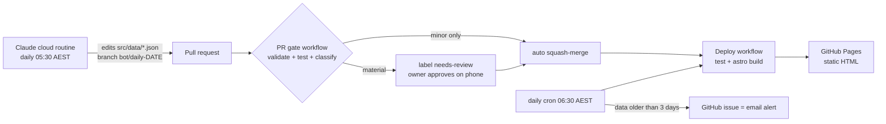

# 02 — Architecture and technical decisions

Roles: Technical Architect (proposal) → Senior Engineer (review) · Status: ACCEPTED v1.0 · Date: 2026-11-20

---

## 1. Owner decisions (from discovery)

| Decision | Choice |
|---|---|
| Brand | Taxshift — loud broadsheet direction (see `docs/03-brand.md`) |
| Daily research | Claude Code cloud routine (Anthropic cloud, owner's Claude plan) |
| Publishing | Minor changes auto-publish; material changes need owner approval via PR |
| Hosting | GitHub Pages, public repo |
| v1 extras | CGT old-vs-new calculator, RSS change feed, glossary |
| Coverage | Federal only; data model is state-ready (`jurisdiction` field) |
| Go-live | Deploy automatically once tests are green |

## 2. System at a glance



Everything runs on GitHub (free) plus the owner's existing Claude plan. No servers, no database, no paid services.

## 3. Architecture decision records

| # | Decision | Why | Rejected |
|---|---|---|---|
| ADR-01 | Astro 7, `output: static` | Prerendered HTML per page (SEO, speed), zero JS by default, small islands where needed | Next.js export (React runtime for static content); Eleventy (no typed islands); plain HTML (no per-page templating) |
| ADR-02 | Data = JSON files in `src/data/`, validated by zod schemas in `src/lib/schema.ts` | Diff-friendly for PR review, AI-agent friendly, strict; one file per measure keeps PRs readable | Astro content collections (couples validation to the Astro build; the agent and CI need to validate without building); YAML (ambiguous typing); a DB/CMS (extra vendor) |
| ADR-03 | Domain logic in framework-free pure TS modules under `src/lib/` | Testable with Vitest, reused by pages, scripts and CI; Astro is only the view layer (dependency inversion) | Logic inside `.astro` components |
| ADR-04 | No UI framework, no Tailwind: Astro components + CSS custom properties (design tokens); vanilla TS for the three interactive bits | Minimal tech; a distinctive look is easier with hand-written CSS than utility defaults | React islands; Tailwind |
| ADR-05 | Persona views are prerendered routes (`/for/property-investors/`) not a JS filter | Works without JS, shareable, indexable | Client-side filtering |
| ADR-06 | Countdowns rendered at build time and refreshed client-side from `data-date` | Correct even if a deploy is missed | Build-time only |
| ADR-07 | All dates are calendar dates in `Australia/Sydney` | Laws start on Australian dates; avoids UTC off-by-one | UTC dates |
| ADR-08 | GitHub Pages via `actions/deploy-pages`; `SITE_URL` and `BASE_PATH` from env | Free, one vendor; custom domain later is a config change | Cloudflare/Vercel (extra account) |
| ADR-09 | Research agent prompt is versioned in the repo (`agent/daily-research.md`); the routine only says "follow that file" | Prompt changes are reviewed like code; portable to a local scheduled task or API runner | Prompt stored only in the routine UI |
| ADR-10 | Publishing gate is a deterministic classifier (`src/lib/classify.ts`), not the agent's judgement | An AI should not decide whether its own change needs review | Agent self-labels PRs |
| ADR-11 | Classifier is fail-closed: an explicit allowlist of minor paths; everything else is material | New fields default to human review | Material-list (fails open) |
| ADR-12 | Deploy on push to `main`, on `workflow_dispatch`, and on a daily cron | Cron refreshes countdowns and runs the stale check even if the agent fails | Deploy only on push |
| ADR-13 | Stale data: banner on site if `meta.lastChecked` > 3 days; cron opens a GitHub issue | Visible honesty + free email alert via GitHub notifications | Paid uptime monitor |
| ADR-14 | Tests: Vitest for unit, data-contract and built-HTML smoke tests | One test tool; fast; runs in CI and for the agent | Playwright (browser downloads, slow) — revisit in v2 |
| ADR-15 | Fonts self-hosted via Fontsource packages | No third-party requests, no privacy leak, faster | Google Fonts CDN |
| ADR-16 | No analytics, cookies or forms in v1 | Privacy NFR, no consent banner, no vendor | GA4 |
| ADR-17 | Neutrality in code: parties never get party colours; stance uses a fixed taxonomy + icon + text | Non-partisan NFR | Party-coloured strips |
| ADR-18 | Scripts run with Node 24 native TypeScript (type stripping), imports use `.ts` extensions | No `tsx`/`ts-node` dependency | Extra runner |

## 4. Data model (summary)

Full zod schema lives in `src/lib/schema.ts`. One JSON file per measure in `src/data/measures/`.

| File | Holds |
|---|---|
| `measures/<id>.json` | Measure: titles, headline, personas, stage, history, dates, big stat, before/after, exemptions, worked example, actions, party positions, sources, `lastVerified` |
| `parties.json` | Party id, name, role (government / opposition / crossbench), leader, treasury spokesperson |
| `election.json` | Last election, earliest likely and latest possible date of the next one, sources |
| `glossary.json` | Term, slug, plain-English definition |
| `changelog.json` | Append-only entries: date, measure, summary, kind (material / minor), source |
| `meta.json` | `lastChecked` timestamp, run id |

## 5. Module map

| Module | Responsibility | Tested by |
|---|---|---|
| `lib/schema.ts` | zod schemas + inferred types | data contract tests |
| `lib/load.ts` | Read + validate all data files into one `SiteData` | unit |
| `lib/rules.ts` | Cross-file business rules (unique ids, known parties, official source for material facts, date sanity) | unit + data contract |
| `lib/dates.ts` | Sydney-calendar date maths, countdown text | unit |
| `lib/status.ts` | Stage + dates → display status (stamp, tone, label) | unit |
| `lib/personas.ts` | Persona catalogue, filtering, slugs | unit |
| `lib/risk.ts` | Party positions + election → "could it flip?" lines | unit |
| `lib/actions.ts` | Split actions into "law: act now" vs "proposed: prepare" | unit |
| `lib/timeline.ts` | Build ordered key-date list incl. election window | unit |
| `lib/cgt.ts` | Old vs new CGT calculator | unit, official examples as test vectors |
| `lib/classify.ts` | Before/after data → material vs minor changes | unit |
| `scripts/validate.ts` | CLI: load + rules, non-zero exit on failure (used by agent + CI) | CI |
| `scripts/classify-pr.ts` | CLI: compare `src/data` at base vs head refs, print JSON verdict | CI |
| `src/pages/**` | Astro views only | built-HTML smoke test |

## 6. Senior Engineer review (challenge → resolution)

| # | Senior Engineer challenge | Architect resolution |
|---|---|---|
| 1 | Content collections give us zod for free — why roll our own loader? | The agent and CI must validate data without running an Astro build, and tests must not depend on Astro internals. The loader is ~40 lines. Accepted. |
| 2 | Build-time countdowns go stale between deploys. | Client script recomputes from `data-date`; daily cron deploy is the backstop (ADR-06, ADR-12). |
| 3 | If the classifier compares JSON, a reordered array looks like a change. | Compare by stable keys (`id`, `party`, `url`, `date+stage`) not array index. Covered by tests. |
| 4 | A fail-open classifier is a liability. | Allowlist of minor paths only: `meta.*`, `measures.*.lastVerified`, additions to `measures.*.sources`, additions to `changelog`. Everything else is material (ADR-11). |
| 5 | Merges made with `GITHUB_TOKEN` don't trigger other workflows, so auto-merge won't deploy. | The gate workflow calls `gh workflow run deploy.yml` after merging; `workflow_dispatch` is exempt from that restriction. |
| 6 | The calculator is the riskiest code: a wrong tax number on a public site. | Pure function, test vectors from official worked examples, inputs validated, every result labelled "estimate, general information", assumptions printed under the result. |
| 7 | GitHub Pages serves under `/taxshift/` until a custom domain exists; hard-coded links will break later. | All internal links go through a `href()` helper using `import.meta.env.BASE_URL`. |
| 8 | What stops the agent inventing facts? | Prompt rules (official sources first, cite every change, "reported" vs "confirmed"), data rule that material facts need a tier-1 source, human approval for material changes, public change log. |
| 9 | What if the routine silently stops? | Freshness stamp on every page, stale banner after 3 days, cron opens an issue (email). |
| 10 | Persona JS filter vs static routes? | Static routes (ADR-05): no JS, shareable, SEO. |

## 7. Repository layout

```
taxshift/
├─ agent/daily-research.md        # versioned prompt for the cloud routine
├─ docs/                          # BA, architecture, brand, runbook
├─ public/                        # favicon, og image, robots.txt
├─ scripts/validate.ts, classify-pr.ts
├─ src/
│  ├─ data/ measures/*.json, parties.json, election.json, glossary.json, changelog.json, meta.json
│  ├─ lib/  schema, load, rules, dates, status, personas, risk, actions, timeline, cgt, classify, href
│  ├─ components/  Masthead, Pill, Stamp, Timeline, FlipMatrix, ActionList, StatusTrack, Footer…
│  ├─ layouts/Base.astro
│  ├─ pages/ index, for/[persona], changes/[id], timeline, calculator, glossary, changelog, about, rss.xml
│  └─ styles/tokens.css, global.css
├─ tests/  unit + data contract + built-html smoke
└─ .github/workflows/ pr-gate.yml, deploy.yml
```

## 8. Operating cost

| Item | Cost |
|---|---|
| GitHub repo, Actions, Pages (public repo) | $0 |
| Claude cloud routine | Inside existing Claude plan |
| Fonts, libraries | $0 (open source) |
| Custom domain (optional, e.g. `taxshift.au`) | ~A$15–30 / year |
